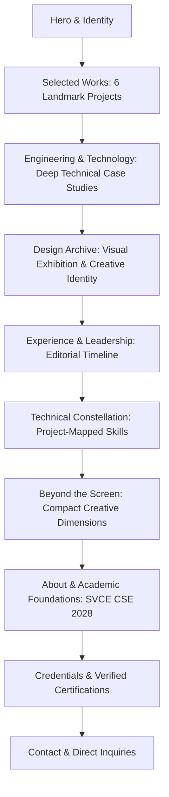

# SOUMYA KUMAR — PORTFOLIO V2 UPGRADE ROADMAP
*Engineering Logic × Creative Instinct | Complete System Overhaul*

---

## 1. Vision & Core Positioning

> **"I combine engineering logic with creative instinct to build meaningful digital experiences."**  
> **Positioning:** Creative Technologist · Software Engineer · Designer  
> **Aesthetic Foundation:** Swiss-inspired editorial grid, Deep Pine (`#0E1613`), Champagne Ivory (`#F4EDE4`), Muted Sage (`#9BB0A5`), and Brushed Metallic Silver.

---

## 2. Information Architecture (V2 Structure)

---

## 3. Implementation Plan & Milestones

### Milestone 1: Types & Data Architecture Refactoring (`src/types/`, `src/data/`)
- Upgrade `src/types/portfolio.ts` to support deep technical case studies (problem, architecture, system modules, challenges, trade-offs, test coverage, outcomes).
- Add full case-study schema for design works (creative brief, audience, concept development, typography, color system, execution).
- Update `src/data/portfolio.ts` with authentic, unembellished case study content for:
  - Technical: CONVERA, NEXORA, VYRA, ResuMatch AI, NetWatch
  - Design: OFFSCRIPT, VÉLORA, Mission Find Nemo, QCIC, Gandhi Jayanti, STTP Series

### Milestone 2: Editorial Navigation & Header (`src/components/layout/`)
- Sleek, modern sticky editorial header with quick section jumps and resume trigger.
- Streamlined entrance option that smoothly transitions without blocking repeat visits.

### Milestone 3: Hero Section Re-engineering (`src/components/sections/HeroSection.tsx`)
- Swiss-inspired asymmetrical masthead with crisp editorial serif and geometric sans-serif.
- Clean integration of the architectural SK monogram.
- High-visibility primary and secondary CTAs (*Explore Selected Work*, *Download Resume*).

### Milestone 4: Selected Works Overhaul (`src/components/sections/WorksSection.tsx`)
- Curate 6 landmark projects with custom differentiated card layouts:
  1. **CONVERA**: Full-stack complaint monitoring with Vitest test suite.
  2. **NEXORA**: Multimodal voice-cloning detection with 18 rule-based heuristics.
  3. **VYRA**: Explainable multi-vector scam detection system.
  4. **ResuMatch AI**: Real-time ATS semantic resume scoring engine (Live on Vercel).
  5. **NetWatch**: Network telemetry collector with MongoDB Atlas cloud persistence.
  6. **OFFSCRIPT**: Cross-disciplinary creator brand identity & digital media art direction.
- Provide direct modal/page routing to in-depth case study views.

### Milestone 5: Case Study System (`src/pages/ProjectDetailPage.tsx`, `CaseStudyModal`)
- Comprehensive, reusable 15-part case study presentation layout.
- Technical project format: Architecture diagram, code breakdown, heuristics, trade-offs, outcomes.
- Design project format: Creative brief, typography spec, color palette swatches, artwork exhibition.

### Milestone 6: Design Archive as Visual Exhibition (`src/components/sections/DesignSection.tsx`)
- Proper exhibition gallery layout with high-resolution artwork inspection.
- Integrated Behance external links (`VIEW ON BEHANCE ↗`) for OFFSCRIPT and VÉLORA.
- Dedicated showcase for QCIC visual identity, STTP credentials, Mission Nemo, and Gandhi Jayanti.

### Milestone 7: Experience, Leadership & Academic Foundations
- Refine `JourneySection.tsx` into a high-density, authoritative editorial career timeline.
- Unify `AboutSection.tsx` and `EngineeringBackgroundSection.tsx` into a compelling narrative chapter.

### Milestone 8: Technical Constellation with Project Mapping (`src/components/sections/SkillsSection.tsx`)
- Map core languages and frameworks to the verified projects that use them.
- Distinct display of verified certifications with credential IDs and issuing authorities.

### Milestone 9: Compact "Beyond the Screen" (`src/components/sections/BeyondTheCodeSection.tsx`)
- Clean, refined 4-dimension overview: Brand Building, Creative Writing, Content Creation, and Music.

### Milestone 10: Contact, SEO & Build Verification
- Professional agency-grade contact closure with instant copy and mailto triggers.
- Full TypeScript check, `npm run build`, and git push to `main`.
